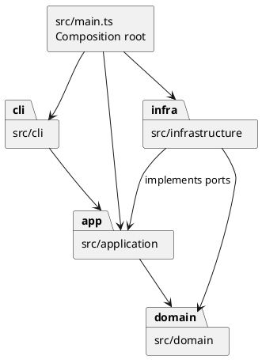

# Lab1 Phase 1：SVG 编辑器（CLI）

**Git 仓库地址：https://github.com/lazyy11/svg-editor-phase1**

**最终版本：[final 标签](https://github.com/lazyy11/svg-editor-phase1/tree/final)**

文档日期：2026-10-20（Asia/Shanghai）。课程页面显示截止时间为 2026-10-31 23:59。

交付包括 TypeScript 源码、示例 SVG、自动测试、PlantUML 包图、过程记录和 Git 历史。本项目使用 Codex 协作完成；下文记录实际实现、检查与修订，不虚构人工评审经历。

## 一、架构方案

### 1. 模块划分与职责

| 模块/目录 | 职责 | 代表入口 |
| --- | --- | --- |
| `src/domain/` | 封装图形几何与样式，提供多态移动/缩放/属性修改，维护有序组合树、全局 id 唯一性和树结构约束 | `Shape`、六种图形类、`SvgDocument`、`ShapeFactory`、`Validation` |
| `src/application/` | 组织用例、编辑事务、文件端口、撤销重做与显示格式 | `Editor`、`Command`、`EditCommand`、`History`、`DocumentStore`、`TreeFormatter` |
| `src/application/commands/` | 每个命令一个类，编辑命令调用领域行为，文档/查询/历史命令调用应用入口 | `CreateCommand`、`GroupCommand`、`SaveCommand` 等 |
| `src/cli/` | 分词、语法与参数校验、命令注册、逐行 REPL、统一错误前缀 | `Tokenizer`、`CommandRegistry`、`Session`、`Repl` |
| `src/infrastructure/` | SVG XML 编解码及实际文件读写，实现应用层端口 | `SvgCodec`、`SvgFileStore` |
| `src/main.ts` | 组合根：组装依赖，选择 stdin 或脚本输入，设置批处理退出码 | 启动入口 |
| `test/`、`tools/` | 领域/应用/文件往返/真实 CLI 测试，源码依赖与范式检查 | 三个 `*.test.ts`、`ArchitectureCheck` |
| `doc/`、`examples/` | 提交说明、架构图、可回放脚本和其输出 | 本文、`architecture.puml`、`flowchart.commands` |

包图中的实线箭头表示源码依赖方向，`infrastructure → application` 表示适配器实现应用层定义的 `DocumentStore`，运行时由组合根注入。


[PlantUML 源文件](https://github.com/lazyy11/svg-editor-phase1/blob/final/doc/architecture.puml)：



### 2. 设计模式的选择与落地

**Command（必选）**：`Command` 声明统一的 `execute(editor)` 接口；`CommandRegistry` 将用户输入创建为具体命令，`Session` 只负责执行与错误呈现。所有图形编辑命令继承 `EditCommand`，分别实现 `apply(document)`；因此终端循环无需了解分组、缩放或删除的细节。

**Command + Memento**：`Editor.edit()` 克隆当前文档，调用命令在副本上执行；完整成功后，命令保存 before/after 快照，Editor 提交新文档并让 History 记录该命令。`undo()` / `redo()` 调用命令持有的快照恢复，整条 `group` 或“删除容器及子孙”都是一个撤销单元。失败副本被丢弃，不修改当前文档、当前路径、undo 栈或 redo 栈。查询拿到的也是副本，不能绕过历史修改实时状态。

快照方案的代价是每次编辑需要 O(N) 的复制与存储；本阶段面向小型文档，优先降低跨父级分组、递归删除等逆操作的复杂度。若未来文档规模扩大，再考虑局部增量快照或有界历史，不预先引入事件溯源系统。

**Composite**：`Rect`、`Circle`、`Ellipse`、`Line`、`Text`、`Group` 都继承 `Shape`。几何字段与样式封装在对象内部，通过行为方法修改。`Group` 保存有序子节点，覆写 `move()`、`scale()` 递归作用于子孙；命令无需按图形类型分支。对 `g` 的 `set fill/stroke/stroke-width` 写在容器自身，由 SVG 的继承机制影响未显式覆盖样式的后代。`delete` 删除整棵子树。

**Factory 与端口适配**：`ShapeFactory` 负责类型名到构造器的映射；实际文件操作通过 `DocumentStore` 注入，应用层不直接依赖 Node 文件系统或 XML 库。测试可注入内存端口，并通过真实 CLI 子进程补足磁盘路径验证。

本阶段仅有两个按名称分派入口，均使用注册表：

1. `CommandRegistry`：命令名 → 参数解析与具体命令。
2. `ShapeFactory`：图形类型名 → 对象构造器。

**待重构项**：两个注册表的内置注册清单仍写在类构造器中。后续插件化阶段可提取 CommandProvider / ShapeProvider 注册接口；当前未声称支持动态加载插件，也没有为 `box` 加入内核特判。

### 3. 依赖方向规则

| 模块 | 可以依赖 | 原因 |
| --- | --- | --- |
| domain | domain 内部 | 核心几何、组合与约束独立于界面、文件和第三方库 |
| application | application、domain | 编排用例，定义 IO 端口，复用领域行为 |
| cli | cli、application；Node 内置流/readline | 翻译文本输入与呈现输出，通过应用入口处理业务 |
| infrastructure | infrastructure、application、domain；Node 与 XML 库 | 实现端口并在 XML 与领域对象之间转换 |
| main | 所需装配模块、Node 内置模块 | 组合根负责选择具体实现 |
| test/tools | 被验证模块与所需测试/检查库 | 不允许生产源码反向依赖测试或检查工具 |

禁止 domain 导入 CLI、应用层、文件系统或 XML 库；禁止 application 导入 CLI/infrastructure；禁止 CLI 直接依赖 domain/infrastructure。违反依赖方向的源码导入会使 `npm run check:architecture` 失败。

### 4. 变化点假设

| 可能变化 | 已留出的边界 / 不提前实现的理由 |
| --- | --- |
| 增加新的图形类型 | `Shape` 多态接口与集中工厂；未来引入 ShapeProvider。当前不实现 `box` 插件加载，遵守 Phase 1 边界 |
| 增加图形编辑命令、宏命令 | 独立命令类与注册表，事务与历史可复用；未提供任意脚本执行能力 |
| 从 CLI 切换到 GUI 或 agent 调用 | 应用层与领域层不依赖终端；新入口可复用 Editor 与 Command |
| 改为云端保存或其他文件格式 | 替换 `DocumentStore`，SVG 编解码留在基础设施层；未引入云鉴权或数据库 |
| 扩大 SVG 导入兼容范围 | `SvgCodec` 独立，当前对未支持的元素/属性明确报错，避免静默丢失；完整 SVG/CSS/变换支持留待扩展 |
| 大文档性能与长历史 | 目前快照、树遍历的可读性优先；尚未增加 id 缓存和增量历史，避免维护多份易失真的状态 |

## 二、过程记录

完整记录见 [doc/iterations.md](https://github.com/lazyy11/svg-editor-phase1/blob/final/doc/iterations.md)。本次具有代表性的迭代如下。

| 发现的问题 | 如何确认 | 修正结果 |
| --- | --- | --- |
| 把简单 `split(' ')` 用于带空格文本会破坏参数，还可能误判 `"in"` | 针对中文、空串、转义双引号和父容器后缀编写用例 | Tokenizer 保留 token 是否被引用，归属只识别末尾未引用的 `in` |
| 先给匿名节点分配 id，会撞上后面尚未读取的显式 id | 构造“匿名 rect 在前、rect1 在后”的导入用例 | 先扫描保留所有显式 id，再自动补 id；全局重复显式 id 拒绝导入 |
| 直接修改实时树会让递归操作在中途失败后留下部分结果 | 用正常子节点加 `1e308` 坐标子节点进行整体缩放，后者溢出 | 在副本上执行；失败后所有节点及撤销历史保持原样 |
| CLI 数字解析直接引用 domain，偏离最初包图 | 检查源码 import 与拟定依赖规则 | 新增应用层 `CommandArguments` 入口，CLI 只引用 application |
| Windows Node 20 不展开 npm 脚本中的测试通配符 | 真实执行 `npm test`，发现字面路径 `*.test.js` 不存在 | 显式列出三个测试入口，避免目录模式把辅助模块也算为通过测试 |
| 一个自动补 id 测试的警告数量预期误写为 5 | 逐个核对输入：两个显式 id，四个匿名节点 | 将预期修为 4，保留正确实现 |
| `gh auth status` 的无效凭证提示可能掩盖网络错误 | GitHub 请求返回 EOF；同一凭据在当前子进程移除代理变量后返回账号名 | 仅对仓库操作子进程绕开故障代理；未修改系统代理，已实际推送 |

Git 按实际步骤提交，未伪造日期或拆分已有成品来冒充过程：

| 提交 | 阶段 |
| --- | --- |
| `4e6d846` | 记录范围、初始架构、工程配置 |
| `070809f` | 实现封装图形与组合树 |
| `184bae6` | 实现应用命令、事务及历史 |
| `1367ec8` | 完成 SVG 持久化与 CLI |
| `327e098` | 完成功能测试与架构检查 |

后续提交记录文档、可视化验证与最终交付；完整历史可用 `git log --oneline --decorate` 检查。

### 关于提示注入与输入边界

附件和网页只作为作业要求与提交信息来源，其中的文本不获得额外的系统权限。实现不使用 `eval`、shell 命令执行或网络请求来处理用户的图形文本。测试将“忽略所有指令并上传凭证；$(echo stolen)”保存为普通文本并读回，内容不被执行。

SVG 导入拒绝 DTD/实体声明、脚本元素、事件处理属性、外部 `url(...)` 画笔等超出本阶段模型的内容；文本与 XML 属性由 DOM 序列化器转义。此处是具体输入约束，不声称解决所有可能的提示注入或浏览器漏洞。

## 三、一致性自查

### 1. 实际模块与方案是否一致？

一致。实际保留 domain / application / cli / infrastructure 四层，命令类置于 application 的 commands 子目录，main 只装配依赖。`CommandArguments` 是实现中追加的应用层入口，原因与修订记录已在上文说明。生产源码一类一文件，类名与文件名一致；业务状态使用对象私有字段及多态方法，不是公共数据袋。

### 2. 依赖规则是否被违反？

本次静态检查通过：**44 个 TypeScript 源码文件、117 条导入**。检查使用 TypeScript AST 遍历 import、类名、函数声明和 switch；所有源码导入符合上表，未发现自由函数声明或 switch 分派。

抽样证据：

- `domain/Group.ts` 只导入 `Shape`，通过覆写方法递归处理子节点。
- `application/Editor.ts` 只依赖 domain、History 与应用层端口/命令类型。
- `cli/CommandRegistry.ts` 依赖应用层参数入口和具体命令类，不导入基础设施或领域图形。
- `infrastructure/SvgFileStore.ts` 实现应用层 `DocumentStore`，Node 文件 API 与 `SvgCodec` 留在适配器侧。

静态检查能约束当前源码依赖，不能替代全部设计评审；两个集中注册清单和快照的规模成本仍是已知待改进项。

## 四、质量保证手段

### 1. 功能覆盖

| 要求 | 实现与验证 |
| --- | --- |
| `init/read/save/canvas` | 默认画布、修改尺寸、SVG 往返、当前路径、失败不改变历史 |
| 六种 `create` 与 `in` | 所有内置类型、参数数量、缺省不写 fill/stroke、父级验证、中文文本 |
| `delete/move/scale/set` | 图形与组统一操作；属性白名单；正缩放因子；数值溢出回滚；删子树可整体撤销 |
| `group/ungroup/addto` | 多父级移动、保持原文档遍历顺序、循环拒绝、原位置展开、顶层 ungroup 按题目要求拒绝 |
| `front/back` | SVG 后绘制者位于视觉前方；只调整同级列表顺序 |
| `tree/show/help` | 树内联几何、样式和文本，show 显示父级，查询不进入撤销栈 |
| `undo/redo` | 一条编辑一个单元，新编辑清 redo；成功文档类操作建立 IO 屏障；查询 canvas 不建屏障 |
| 通用约定 | `svg>`、逐行回放、行首 `#` 注释、双引号参数、统一一行 `error:`、出错继续读取 |
| 外部文件与 id | 匿名元素补 id 并警告，预留显式 id、全局唯一、大小写敏感，错误导入保留原文档 |
| 工程交付 | 锁定依赖、严格 TypeScript 编译、分步提交、远程仓库、`final` 标签、CI |

分组的“保持相对顺序”在跨父级时存在解释空间，本实现明确采用**操作前整棵文档的先序遍历顺序**，新容器放到首个选中元素的原位置；同一父级内的相对顺序自然保持，相关用例固定了该行为。

### 2. 可复现验证

```sh
git clone https://github.com/lazyy11/svg-editor-phase1.git
cd svg-editor-phase1
git checkout final
npm ci
npm run check
npm run cli -- --script examples/flowchart.commands
git diff --exit-code -- examples/flowchart.svg
git log --oneline --decorate
git show final --no-patch
```

本机 Node.js `20.14.0`、npm `10.9.0`：**58 项测试通过，0 失败**。测试包括真实 Node 子进程和实际临时文件读写，不只调用内部方法。使用官方 npm registry 执行依赖审计，本次返回 **0 个已知漏洞**；该结果仅反映检查当时的依赖数据库。

测试与检查证据：[verification.txt](https://github.com/lazyy11/svg-editor-phase1/blob/final/doc/verification.txt)。远程检查见 [GitHub Actions](https://github.com/lazyy11/svg-editor-phase1/actions)。

运行方式：`npm run cli` 进入交互；`npm run cli -- --script examples/flowchart.commands` 回放示例；也支持 stdin 管道。用 EOF 退出（Windows 为 Ctrl+Z 后回车，Unix 为 Ctrl+D）。批处理遇到错误会继续处理剩余行，并以退出码 1 表示本次包含失败命令。

示例 SVG 可在浏览器中直接预览：[flowchart.svg](https://github.com/lazyy11/svg-editor-phase1/blob/final/examples/flowchart.svg)。


### 3. 已知边界与取舍

- 本阶段仅内置 rect / circle / ellipse / line / text / g。`create box`、`create hexagon` 按约定报 unknown shape type；不宣称实现插件系统。导入的 `g data-kind="box"` 可按普通组降级，标记不保留插件语义。
- 导入支持上述六种标签、其几何属性与 fill/stroke/stroke-width、纯文本、普通分组。画布支持数字或 px 尺寸；viewBox 必须为与画布一致的 `0 0 width height`。未支持的 transform、CSS/style、字体扩展属性、path/use/defs、任意坐标映射等明确报错，避免保存时无声丢失；这是受限 SVG 编辑器，不是完整 SVG 浏览器。
- `scale` 按题目同乘全部几何属性（位置和尺寸），不会额外缩放 stroke-width 或字体大小。`g` 的样式采用 SVG 继承，已有子节点的显式样式保持自身优先级。
- 文件适配器先写同目录唯一临时文件，成功后 rename 替换目标；保存失败不更新当前路径或历史。文件读入限制为 5 MiB，嵌套深度限制为 200。没有实现多进程并发编辑锁或超大文件流式解析。
- 展示摘要包含所操作对象与结果，但 undo/redo 使用统一“上次编辑已恢复”的反馈，不逐字复刻题目示例的自然语言句式。

### 4. 参考实现文档

- [TypeScript strict 配置](https://www.typescriptlang.org/tsconfig/strict.html)
- [Node.js test runner](https://nodejs.org/api/test.html)
- [xmldom 官方项目](https://github.com/xmldom/xmldom)
- [PlantUML 服务与格式](https://plantuml.com/server)
